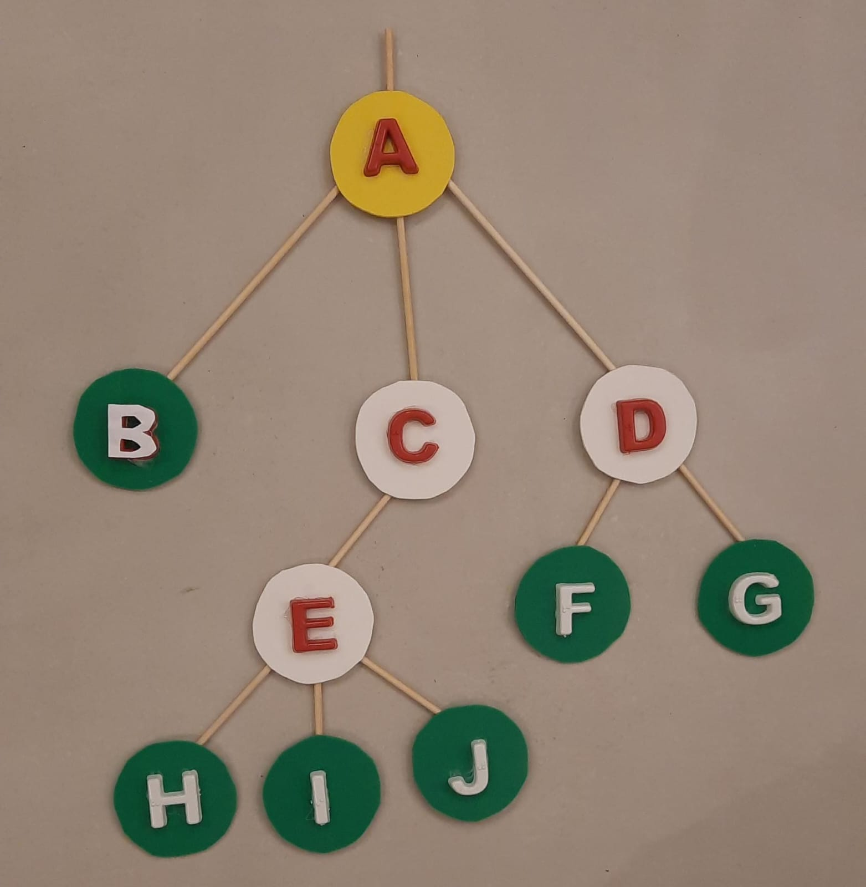
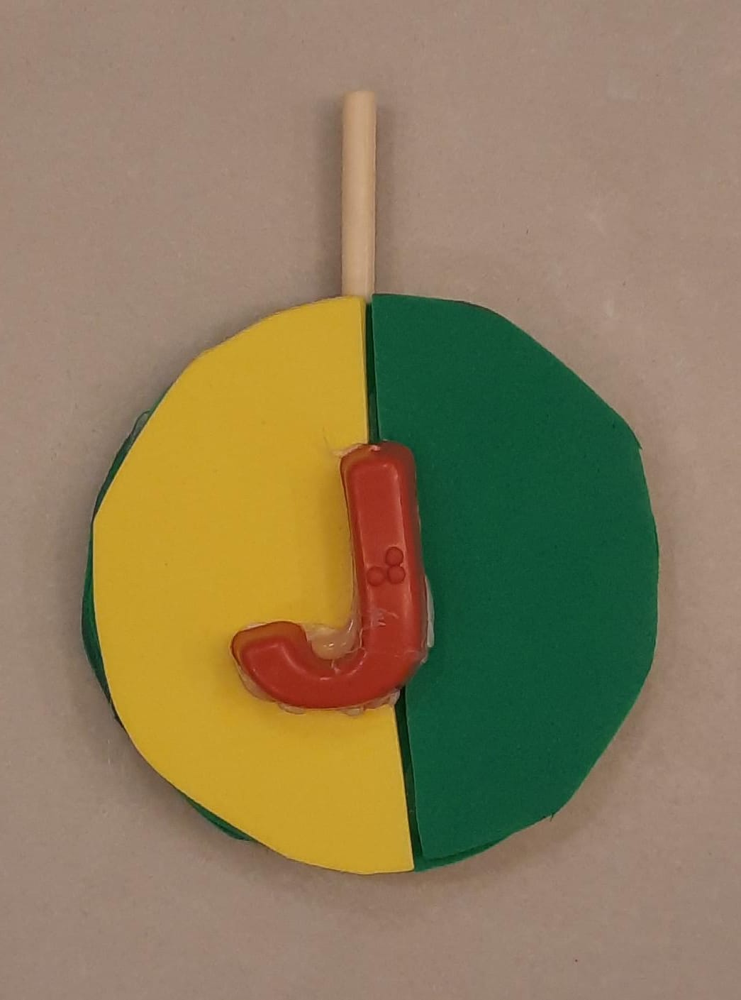
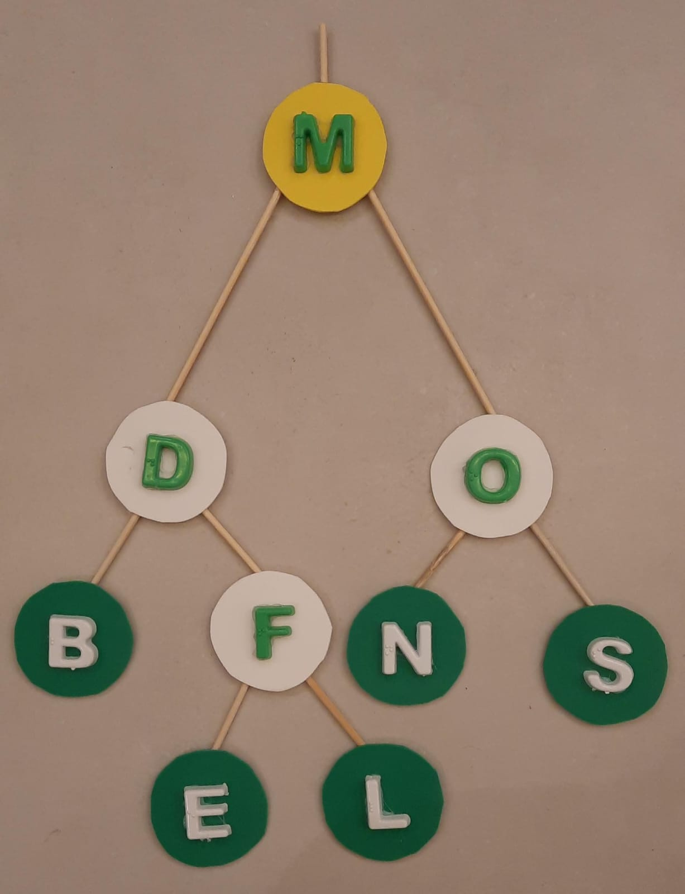
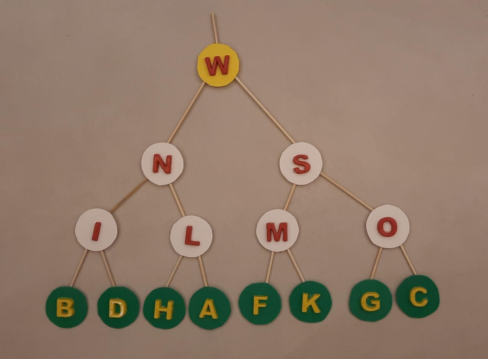
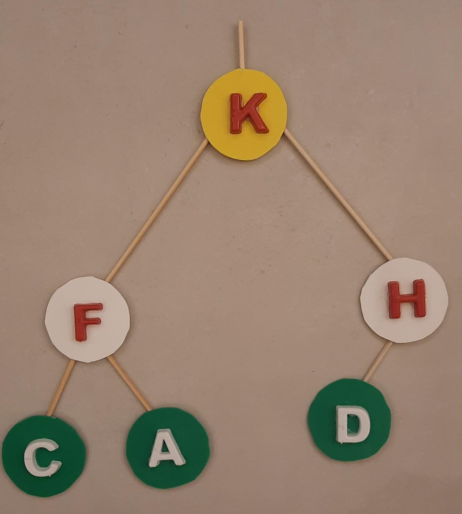
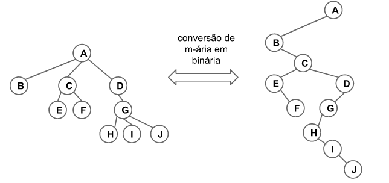
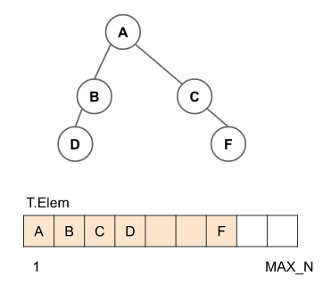
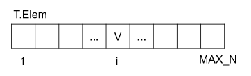
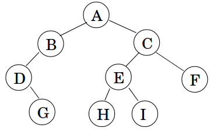
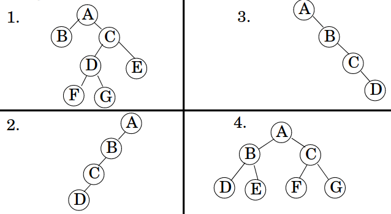

# Árvores

------

## Pré-Requisitos

São requisitos para essa aula:

- Introdução/Fundamentos de Programação (em alguma linguagem de programação)
- Interesse em aprender C/C++
- Noções de recursividade
- Noções de tipos de dados
- Noções de listas e encadeamento

*Agradecimentos especiais ao prof. Fabiano Oliveira e prof. Fábio Protti, cujos conteúdos didáticos formam a base desses slides*

# Tipo Abstrato: Árvore

------

## Árvore

A *Árvore* (do inglês *Tree*), ou *Árvore Enraizada*, é um Tipo Abstrato de Dado (TAD) que pode assumir duas formas:

- árvore $T$ vazia, denotada por $T = \emptyset$
- árvore $T$ não-vazia, composta por:
   * um nó $R$ chamado de *nó raiz*
   * $0$ ou mais árvores disjuntas $T_1$, $T_2$, ..., associadas a $R$; tais árvores são chamadas de *subárvores*

{height=40%}

-------

## Nomenclatura

Um conjunto de árvores é chamado *floresta*. 
Se T é árvore com raiz R:

- os *nós de T* são todas as raízes de subárvores de R, além da raiz de T
- um nó com 0 filhos é chamado de *folha* (do inglês *leaf*)
- se um nó F é um *filho* de um nó P, denominamos P como *pai* de F
- a raiz é um nó *ancestral* de todos nós da árvore
- todos os nós da árvore são descendentes do nó raiz

:::::::::: ||

::::: |{45%}

{height=40%}

:::::

::::: |{45%}

{height=40%}

:::::

::::::::::


-------

## Caminhos

Um caminho em uma árvore é uma *sequência de nós* com relação *filho de* ou *pai de*:

{height=40%}

**Exemplos:** 

- F, D, A
- C, E, J
- B, A, D, F


-------

## Tamanho de Caminhos e Níveis

O *tamanho de um caminho* consiste no número de nós. O *nível* de um nó é o tamanho de seu caminho até a raiz:

{height=40%}


**Nível de:** A=1; C=2; F=3; J=4.  

**Desafio:** em cursos de Teoria dos Grafos é provado que existe um único caminho conectando dois nós na árvore. *Utilize sua intuição para verificar esta afirmação!*

--------

## Alturas

A *altura* de nó X é o tamanho do maior caminho que conecta X a uma folha descendente. Denotamos a altura de $X$ por $h(X)$:

{height=40%}

**Alturas:** $h(B)=1$; $h(C)=3$; $h(D)=2$; $h(A)=4$.  

A *altura da árvore* é a altura de sua raiz! 

No exemplo, $h(T) = h(A) = 4$.


--------

## Aridade

Uma árvore é dita *ordenada* se há uma ordem associada aos filhos de cada nó.

Uma árvore é dita $m$*-ária* se cada nó é *limitado a um máximo* de $m$ filhos.

{height=40%}

A árvore acima é ternária (podendo também ser $4$-ária, $5$-ária, $6$-ária, ...), mas *não é binária*!

--------

## Filho esquerdo e direito

Em *árvores binárias ordenadas* de raiz R, a primeira subárvore de cada nó é denominada *subárvore à esquerda de R* (cuja raiz se chama *filho esquerdo*), e a segunda é a *subárvore à direita de R* (cuja raiz se chama *filho direito*).

{height=40%}

**Exemplo:** $D$ é filho esquerdo de $M$; e $O$ é filho direito de $M$

--------

## Folha Externa, Semifolha e Nó Cheio

Em uma árvore $m$-ária, cada nó possui $m$ subárvores (algumas possivelmente vazias):

- uma subárvore vazia é chamada de *folha externa* (ou *nó externo*)
- um nó com alguma folha externa é chamado de *semifolha*
- um nó sem folha externa (isto é, com exatamente $m$ filhos) é chamado de *nó cheio*

::::::: ||

::: |{45%}

{height=40%}

:::

::: |{45%}

**Exemplo:** $M$ é nó cheio; $D$ e $O$ são semifolhas.
$E$, $L$ e $N$ são folhas, portanto também semifolhas.
Toda folha é semifolha (com $m$ folhas externas), e todo nó é *ou* cheio *ou* semifolha.

**Desafio:** quantas folhas externas existem em uma árvore binária com $n$ nós?

. . .

**Solução:** $n+1$ (são $2n$ arestas, e $n-1$ deles apontam para nós).

:::

:::::::


**Observação:** O termo *nó externo* segue [Knuth97] (árvore binária estendida).


--------

## S-valor (ou Rank)

O *s-valor* (ou *rank*) de um nó $X$ é o tamanho do menor caminho que conecta $X$ a uma *semifolha* descendente. Denotamos o s-valor de $X$ por $s(X)$.

::::::::::{.columns}

:::::{.column width=45%}

{height=30%}

:::::

:::::{.column  width=50%}

{height=30%}

:::::

::::::::::

**S-valores de D, O e M:** $A2$: 1, 1 e 2; $A3$: 2, 2 e 3.

Toda semifolha (ou folha) tem s-valor $1$, e uma folha externa tem s-valor $0$. Note que $h(M) = 4$ em ambas, e em geral, $s(X) \leq h(X)$.

**Observação:** Também chamado de *s-value*, *dist* [Knuth97] ou *null path length*. É utilizado em *heaps esquerdistas* (do inglês, *leftist heaps*).


--------

## Estritamente $m$-ária

Uma árvore *estritamente $m$-ária* é aquela na qual cada nó possui *exatamente* $0$ ou $m$ filhos.


::::::::::{.columns}

:::::{.column width=45%}

{height=40%}

:::::

:::::{.column  width=50%}

{height=40%}

:::::

::::::::::

**Exemplo:** Considere a inclusão de um filho à esquerda de $D$, e outro à direita de $O$.

**Observação:** Chamada pelo NIST de [full binary tree](https://xlinux.nist.gov/dads/HTML/fullBinaryTree.html), embora também seja preferivelmente chamada de *própria* (ou *proper*).

--------

## Árvore Perfeita (ou Cheia)

Uma *árvore $m$-ária perfeita* (ou *cheia*) é aquela na qual todo nó com alguma subárvore vazia está no *último nível*.

{height=50%}

**Observação:** Chamada pelo NIST de [perfect binary tree](https://xlinux.nist.gov/dads/HTML/perfectBinaryTree.html) (ou *perfect k-ary tree*), embora também seja chamada de *full* ou, preferencialmente *perfect*.

--------

## Árvore Completa (ou Quase-Completa)

Uma *árvore $m$-ária completa* é aquela na qual todo nó com alguma subárvore vazia está no *último ou penúltimo níveis, estando os nós do último nível completamente preenchidos da esquerda para a direita*.

{height=40%}


**Observação:** Chamada pelo NIST de [complete binary tree](https://xlinux.nist.gov/dads/HTML/completeBinaryTree.html). Note que alguns autores consideram essa mesma definição para árvores cheias ou perfeitas.
*O ponto fundamental é a facilidade de implementação em vetores (vide próximos slides).* [Knuth97][^1]

[^1]: [Knuth97] Donald E. Knuth, The Art of Computer Programming, Addison-Wesley, volumes 1 and 2, 2nd edition, 1997. 

--------

## Número Mínimo e Máximo de Nós

Seja $N_{min}(h)$ o *menor* e $N_{max}(h)$ o *maior* número de nós de uma árvore binária de altura $h$. Assim, $N_{min}(h) \leq n \leq N_{max}(h)$.

**Desafio:** defina-os recursivamente e encontre suas fórmulas fechadas.

. . .

**Mínimo:** uma subárvore mínima de altura $h-1$ e outra vazia: $N_{min}(h) = 1 + N_{min}(h-1)$, logo $N_{min}(h) = h$ (um *caminho*).

**Máximo:** duas subárvores máximas de altura $h-1$: $N_{max}(h) = 1 + 2 \cdot N_{max}(h-1)$, logo $N_{max}(h) = 2^h - 1$ (árvore *perfeita*).

Em ambos os casos, a árvore vazia tem $N_{min}(0) = N_{max}(0) = 0$.

--------

## Número Mínimo de Nós: Estritamente Binária

Seja $N'_{min}(h)$ o menor número de nós de uma árvore estritamente binária de altura $h \geq 1$.

**Desafio:** encontre $N'_{min}(h)$. E o máximo?

. . .

Para $h \geq 2$, a raiz precisa de dois filhos: uma subárvore mínima de altura $h-1$ e uma folha. Logo, $N'_{min}(h) = 2 + N'_{min}(h-1)$, com $N'_{min}(1) = 1$, e $N'_{min}(h) = 2h - 1$.

O máximo não muda: a árvore perfeita é estritamente binária, com $2^h - 1$ nós.

--------

## Desafios (Exercícios Práticos)

1. Qual a altura máxima de uma árvore binária com $n$ nós?

2. Qual a altura máxima de uma árvore estritamente binária com $n$ nós?

3. Qual a altura mínima de uma árvore binária com $n$ nós?

4. Numa árvore binária perfeita com $n$ nós, qual o número de nós no último nível?

. . .

**Solução:**

1. De $N_{min}(h) = h \leq n$: altura máxima $n$ (caminho com $n$ nós)
2. De $N'_{min}(h) = 2h - 1 \leq n$, temos $h \leq (n+1)/2$: altura máxima $(n+1)/2$
3. De $n \leq N_{max}(h) = 2^h - 1$, temos $h \geq lg(n+1)$: altura mínima $\lceil lg(n+1) \rceil$
4. O nível $k$ tem $2^{k-1}$ nós e $n = 2^h - 1$ (ou seja, $2^h = n+1$). Logo, o último nível tem $2^{h-1} = 2^h/2 = (n+1)/2$ nós

--------

## Árvore Balanceada

Dado um fator $c$ (tipicamente $c=2$ ou $>= 2$), uma árvore é *$c$-balanceada* se, para todo nó $X$, vale $h(X) \leq c \cdot s(X)$. 

::::::::::{.columns}

:::::{.column width=45%}

{height=30%}

:::::

:::::{.column  width=50%}

{height=30%}

:::::

::::::::::

**Exemplo:** $A3$ é balanceada. $A2$ não é: a raiz satisfaz $h(M) = 4 \leq 2 \cdot 2$, mas $h(D)=3 > 2 \cdot 1$.

Árvores AVL e rubro-negras são balanceadas com $c=2$ (veremos a seguir nesse curso).

**Observação:** com $c < 2$, um nó com um único filho tem $s = 1$ e $h >= 2$. Com $c < 2$, a árvore seria estritamente binária, com $n$ sempre ímpar: impossível inserir um elemento por vez!

--------

## Altura de Árvores Balanceadas (Exercício Prático)

Veremos que uma árvore $c$-balanceada com $n$ nós tem altura $h \leq c \cdot lg(n+1)$.

Seja $R$ a raiz da árvore.

1. Não há semifolha acima do nível $s(R)$, logo os níveis $1$ a $s(R)$ estão cheios: $n \geq N_{max}(s(R)) = 2^{s(R)} - 1$, ou seja, $s(R) \leq lg(n+1)$
2. Como a árvore é balanceada, $h(R) \leq c \cdot s(R)$
3. Logo, $h(R) \leq c \cdot lg(n+1)$ $\blacksquare$

**Exemplo:** com $c = 2$ e $n = 2^{20} - 1$ nós (cerca de um milhão), temos $lg(n+1) = 20$, e a altura é no máximo $40$ (contra $2^{20} - 1$ no pior caso de uma árvore binária qualquer!).

**Observação:** a demonstração usou a condição só na raiz! Exigi-la em todo nó garante que *toda subárvore* também tenha altura logarítmica.

--------


# Implementações

--------

## Implementações de Árvores

Apresentaremos dois tipos de implementação para o TAD Árvore: Sequencial e Encadeada.

Note que, nesse momento, não apresentaremos *operações* sobre o TAD Árvore, focando somente em sua *representação interna*. 
A razão é que existem diversos tipos específicos de árvores, que apresentam operações distintas no TAD, de acordo com seu propósito.

--------

## Implementação Encadeada 1 ($m$-ária)

Consideramos uma implementação de árvore $m$-ária, com alocação encadeada de nós (alocação interna sequencial para filhos).


```.cpp
constexpr int M = 4;     // aridade M=4 (quaternária)
struct NoEnc1 {
   char chave;           // dado armazenado
   NoEnc1* nosFilhos[M]; // ponteiros para filhos
};

struct ArvoreEnc1 {
  NoEnc1* raiz;          // raiz da árvore
};
```

--------

## Implementação Encadeada 1 ($m$-ária)

{width=40%}


--------

## Implementação Encadeada 2 ($m$-ária)

Consideramos uma implementação de árvore $m$-ária, com alocação encadeada de nós.


```.cpp
constexpr int M = 4;     // aridade M=4 (quaternária)
struct NoEnc2 {
   char chave;           // dado armazenado
   NoEnc2* prox;         // proximo elemento
   NoEnc2* nosFilhos;    // ponteiro único para filhos
};

struct ArvoreEnc2 {
  NoEnc2* raiz;          // raiz da árvore
};
```


--------

## Implementação Encadeada 2 ($m$-ária)

Consideramos uma implementação de árvore $m$-ária, com alocação encadeada de nós.


{width=40%}

--------

## Implementação Encadeada 3 (binária)

Note que podemos reescrever os ponteiros de `NoEnc2` com os termos `esq` e `dir` (nó esquerdo e nó direito).


```.cpp
struct NoEnc3 {
   char chave;     // dado armazenado
   NoEnc3* esq;    // filho esquerdo
   NoEnc3* dir;    // filho direito
};

struct ArvoreEnc3 {
  NoEnc3* raiz;    // raiz da árvore
};
```

--------

## Implementação Encadeada 3 (binária)

Consideramos uma implementação de árvore binária, com alocação encadeada de nós.


{width=40%}

--------


## Implementação Encadeada 4 (binária) - unique_ptr

**AVISO:** *Tópico Avançado!*

Note que podemos reescrever os ponteiros de `NoEnc3` utilizando `unique_ptr`, para maior segurança:


```.cpp
struct NoEnc4 {
   char chave;                     // dado armazenado
   std::unique_ptr<NoEnc4> esq;    // filho esquerdo
   std::unique_ptr<NoEnc4> dir;    // filho direito
};

struct ArvoreEnc4 {
  std::unique_ptr<NoEnc4> raiz;    // raiz da árvore
};
```

--------

## Implementação Encadeada 5 (binária) com pai

Note que podemos reescrever os ponteiros de `NoEnc3` também para incluir um nó pai:


```.cpp
struct NoEnc5 {
   char chave;     // dado armazenado
   NoEnc5* esq;    // filho esquerdo
   NoEnc5* dir;    // filho direito
   NoEnc5* pai;    // pai
};

struct ArvoreEnc5 {
   NoEnc5* raiz;   // raiz da árvore
};
```


--------

## Conversão para Árvores Binárias

Observamos pelas implementações `NoEnc2` e `NoEnc3` que uma árvore $m$-ária *qualquer* pode ser convertida para uma árvore binária. Isso reforça a importância do estudo de implementações eficientes para árvores binárias.

{width=70%}

--------


## Implementação Sequencial

As Árvores com Implementação Sequencial utilizam um array para armazenar os dados.
Assim, os dados sempre estarão em um *espaço contíguo* de memória.

**Desafio:** quanto espaço é necessário para armazenar uma *árvore qualquer* com altura $h$?

-------

## Implementação ArvoreSeq1

Consideraremos uma árvore sequencial com, no máximo, `MAX_N` elementos do tipo caractere.

```.cpp
constexpr int MAX_N = 50; // capacidade máxima da árvore
struct ArvoreSeq1 {
  char elem [MAX_N];      // elementos na árvore
};
```

**Desafio:** Quantos níveis *cabem* nessa árvore? $\lceil log_2(50+1) \rceil = 6$

------

## Desafios na ArvoreSeq1

Note que, para esse fim, somente as *árvores completas* terão maior eficiência, utilizando uma *representação por níveis*.

{width=40%}

**Desafio:** onde fica o primeiro elemento de cada nível da árvore $T$?

--------

## Localização na ArvoreSeq1

Dado um nó $V$ na posição $i$ da árvore sequencial $T$, em que posição estão:

- o pai de $V$?
- os filhos de $V$?

{width=50%}

. . . 

**Resposta:** considerando contagem 1..MAX_N, estarão respectivamente nas posições $\lfloor i/2 \rfloor$ (pai), $2i$ e $2i+1$ (filhos).

**Desafio:** considere a contagem 0..MAX_N-1 e refaça o cálculo. 

. . .

**Solução:** posições $\lfloor (i-1)/2 \rfloor$ (pai), $2i+1$ e $2i+2$ (filhos).


# Percursos em Árvores

-------

## Percursos em Árvores

Como "imprimir" uma árvore?

Estruturas lineares tem uma intuição mais direta para o conceito de impressão, mas para estruturas arbóreas isso já não é tão direto.
Além da impressão, muitas vezes é desejável efetuar outras operações ou *visitas* em nós de uma árvore.

Operações de *Percursos em Árvore* (do inglês, *tree traversals*) apresentam uma solução para isso:

- Percurso de pré-ordem (do inglês, *preorder*)
- Percurso de pós-ordem (do inglês, *postorder*)
- Percurso em-ordem ou ordem simétrica (do inglês, *inorder*)

-------

## Percursos: definições e aplicações

No percurso de *pré-ordem*, o nó é visitado primeiro, depois os filhos esquerdos, e finalmente, são visitados os filhos direitos.

- **Aplicação:** impressão da ordem de visita (pilha de execução) para algoritmos recursivos em árvore.

No percurso de *pós-ordem*, os filhos esquerdos são visitados primeiro, depois os filhos direitos, e finalmente o nó é visitado.

- **Aplicação:** calcular altura de um nó (note que a altura de um nó depende da altura de seus filhos).

No percurso *em-ordem*, os filhos esquerdos são visitados primeiro, depois o nó é visitado, e finalmente os filhos direitos são visitados.

- **Aplicação:** impressão "visual" da árvore como caracteres na tela (desafio!). Visita ordenada em árvores com propriedades de busca e mapas (próxima aula).


-------

## Percurso Pré-ordem


::::::::::: ||

:::::: |{30%}

```.cpp
void preordem(auto* no) {
   if(no) {
      // operação ou "visita"
      println("{}", no->chave);
      preordem(no->esq);
      preordem(no->dir);   
   }
}
```


::::::

:::::: |{10%}

::::::

:::::: |{55%}

{width=50%}

::::::

::::::::::: 

-------

## Pratique: Pré-ordem

Apresente o percurso de pré-ordem para as árvores abaixo:

{width=60%}

. . . 

**Solução:** 1. ABCDFGE 2. ABCD 3. ABCD 4. ABDECFG 

-------

## Percurso Pós-ordem

::::::::::: ||
:::::: |{30%}

```.cpp
void posordem(auto* no) {
   if(no) {
      posordem(no->esq);
      posordem(no->dir);   
      // operação ou "visita"
      println("{}", no->chave); 
   }
}
```
::::::
:::::: |{10%}
::::::
:::::: |{55%}

{width=50%}

::::::
:::::::::::

-------

## Pratique: Pós-ordem

Apresente o percurso de pós-ordem para as árvores abaixo:

{width=60%}

. . . 

**Solução:** 1. BFGDECA 2. DCBA 3. DCBA 4.DEBFGCA


-------

## Percurso Em-ordem (ordem simétrica)

::::::::::: ||
:::::: |{30%}

```.cpp
void emordem(auto* no) {
   if(no) {
      emordem(no->esq);
      // operação ou "visita"
      println("{}", no->chave);
      emordem(no->dir);   
   }
}
```
::::::

:::::: |{10%}
::::::

:::::: |{55%}


{width=50%}

::::::
::::::::::: 


-------

## Pratique: Em-ordem

Apresente o percurso de ordem simétrica para as árvores abaixo:

{width=60%}

. . . 

**Solução:** 1. BAFDGCE 2. DCBA 3. ABCD 4. DBEAFCG


## Fim percursos

Fim parte de percursos.


# Operações Básicas em Árvores (Exercícios Práticos)

## Exercício: Calcule a altura de uma árvore encadeada

Dado um nó do tipo `NoEnc3`, calcule a altura da árvore, com método:

`int altura(auto* const no) { ... }`

:::::::: ||

::::: |{30%}

```.cpp
struct NoEnc3 {
   char chave; 
   NoEnc3* esq; 
   NoEnc3* dir; 
};
```

:::::

. . .

::::: |{55%}

```.cpp
int altura(auto* const no) {
    if (!no) return 0;
    int he = altura(no->esq);
    int hd = altura(no->dir);
    if(he > hd) return he+1;
    else        return hd+1;
}
```

:::::

::::::::


--------

## Exercício: Calcule o nível de um nó em árvore encadeada

Dado um nó do tipo `NoEnc3` e um nó raiz, calcule o nível do nó com o método:

`int nivel(auto* no, auto* raiz) { ... }`

:::::::: ||
::::: |{30%}

```.cpp
struct NoEnc3 {
   char chave; 
   NoEnc3* esq; 
   NoEnc3* dir; 
};
```

:::::

. . .

::::: |{55%}

```.cpp
int nivel(auto* no, auto* raiz) {
    if (!raiz) return 0;
    if (no == raiz) return 1;
    int esq = nivel(no, raiz->esq);
    if (esq != 0) return 1 + esq;
    int dir = nivel(no, raiz->dir);
    if (dir != 0) return 1 + dir;
    return 0; // nós em árvores distintas
}
```

:::::
::::::::

**Exercício:** Qual nível de C na seguinte árvore completa: A B C D.

---------

## Exercício: Calcule o rank (s-valor) de um nó em árvore encadeada

O **rank** (ou **s-valor**) de um nó é a distância até a **folha externa** (subárvore vazia) mais próxima. Uma folha externa tem rank 0.

Dado um nó do tipo `NoEnc3`, calcule seu rank com o método:

`int svalor(auto* no) { ... }`

:::::::: ||
::::: |{30%}

```.cpp
struct NoEnc3 {
   char chave; 
   NoEnc3* esq; 
   NoEnc3* dir; 
};
```

:::::

. . .

::::: |{55%}

```.cpp
int svalor(auto* no) {
    if (!no) return 0; // folha externa
    int esq = svalor(no->esq);
    int dir = svalor(no->dir);
    return 1 + std::min(esq, dir);
}
```

:::::
::::::::

**Exercício:** Qual o rank de A e de B na seguinte árvore completa: A B C D.

---------

## Exercício: Propriedade de ser filho direito

Dado um nó do tipo `NoEnc5` com pai, escreva a propriedade:

`bool eh_filho_direito(auto* f) { ... }`

:::::::: ||

::::: |{30%}

```.cpp
struct NoEnc5 {
   char chave;  
   NoEnc5* esq; 
   NoEnc5* dir;
   NoEnc5* pai;
};
```

:::::

. . .

::::: |{55%}

```.cpp
bool eh_filho_direito(auto* f) 
// pre(f && f->pai)   // C++26
{
    return f == f->pai->dir;
} 
```

:::::

::::::::

---------


## Exercício: Propriedade de ter no máximo zero ou um filho

Dado um nó do tipo `NoEnc5` com pai, escreva sa propriedades:

`bool tem_zero_filhos(auto* no) { ... }`

`bool tem_um_ou_zero_filhos(auto* no) { ... }`

:::::::: ||

::::: |{30%}

```.cpp
struct NoEnc5 {
   char chave;  
   NoEnc5* esq; 
   NoEnc5* dir;
   NoEnc5* pai;
};
```

:::::

. . .

::::: |{55%}

```.cpp
bool tem_zero_filhos(auto* const no) 
// pre(no)  // C++26
{ return !no->esq && !no->dir; } 

bool tem_um_ou_zero_filhos(auto* const no) 
// pre(no)  // C++26
{ return !no->esq || !no->dir;}
```

:::::

::::::::

---------


## Exercício: Extrair um nó que tem no máximo um filho

Dado um nó do tipo `NoEnc5` com pai, 
faça uma operação que extrai da árvore um nó que tem no máximo um filho.
Essa operação retorna o ponteiro do nó pai e nó filho, se houver, 
e ajusta o nó para que seu filho seja conectado a seu pai: `auto extrai(auto* const no) { ... }`

::: -

:::::::: ||
::::: |{30%}

```.cpp
struct NoEnc5 {
   char chave;  
   NoEnc5* esq; 
   NoEnc5* dir;
   NoEnc5* pai;
};
```

:::::

. . .

::::: |{60%}

```.cpp
auto extrai(auto* const no)
// pre(tem_um_ou_zero_filhos(no))  // C++26
// post(tem_zero_filhos(no))       // C++26
{
    auto* filho = no->esq ? no->esq : no->dir;
    auto* pai   = no->pai;
    if (filho) filho->pai = pai;
    if (pai) {
        if (eh_filho_esquerdo(no)) pai->esq = filho;
        else                       pai->dir = filho;
    }
    no->pai = no->esq = no->dir = 0;
    return std::tuple{pai, filho};
}
```

:::::
::::::::

:::

---------

## Fim exercícios práticos resolvidos

Fim parte de exercícios práticos resolvidos.

Continue na lista de exercícios! Pratique!


## Bibliografia Recomendada


Além da bibliografia do curso, recomendamos para esse tópico:

- Szwarcfiter, J.L; Markenzon, L. Estruturas de Dados e seus Algoritmos. Rio de Janeiro, LTC, 1994.
Bibliografia Adicional:
- Cerqueira, R.; Celes, W.; Rangel, J.L. Introdução a estruturas de dados: com técnicas de programação em C. Editora, 2004.
- Cormen, T.H.; Leiserson, C.E.; Rivest, R.L.; Stein Algoritmos: Teoria e Prática. Ed. Campus, 2002.
- Cormen, T.H.; Leiserson, C.E.; Rivest, R.L.; Stein, C. Introduction to Algorithms, 3rd ed.. The MIT Press, 2009.
- Preiss, B.R. Estruturas de Dados e Algoritmos Ed. Campus, 2000;
- Knuth, D.E. The Art of Computer Programming - Vols I e III. 2nd Edition. Addison Wesley, 1973.
- Graham, R.L., Knuth, D.E., Patashnik, O. Matemática Concreta. Segunda Edição, Rio de Janeiro, LTC, 1995.
- Livro "The C++ Programming Language" de Bjarne Stroustrup
- Dicas e normas C++: https://github.com/isocpp/CppCoreGuidelines


# Agradecimentos

-----

## Pessoas

Em especial, agradeço aos colegas que elaboraram bons materiais, como o prof. Fabiano Oliveira (IME-UERJ), e o prof. Jayme Szwarcfiter cujos conceitos formam o cerne desses slides.

Estendo os agradecimentos aos demais colegas que colaboraram com a elaboração do material do curso de [Pesquisa Operacional](https://github.com/igormcoelho/curso-pesquisa-operacional-i), que abriu caminho para verificação prática dessa tecnologia de slides.

-----

## Software

Esse material de curso só é possível graças aos inúmeros projetos de código-aberto que são necessários a ele, incluindo:

- pandoc
- LaTeX
- GNU/Linux
- git
- markdown-preview-enhanced (github)
- visual studio code
- atom
- revealjs
- groomit-mpx (screen drawing tool)
- xournal (screen drawing tool)
- ...

-----

## Empresas

Agradecimento especial a empresas que suportam projetos livres envolvidos nesse curso:

- github
- gitlab
- microsoft
- google
- ...

-----

## Reprodução do material

Esses slides foram escritos utilizando pandoc, segundo o tutorial ilectures:

- https://igormcoelho.github.io/ilectures-pandoc/

Exceto expressamente mencionado (com as devidas ressalvas ao material cedido por colegas), a licença será Creative Commons.

**Licença:** CC-BY 4.0 2020

Igor Machado Coelho

-------

## This Slide Is Intentionally Blank (for goomit-mpx)
