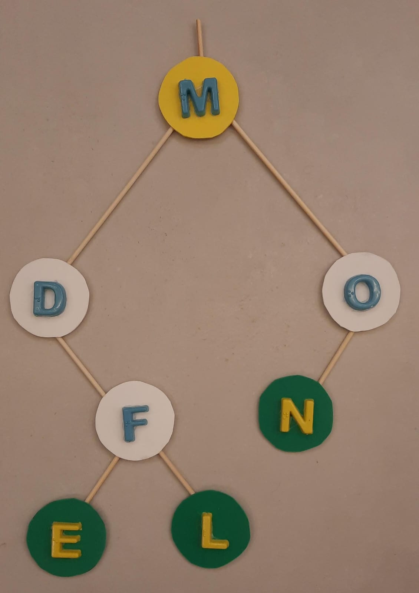
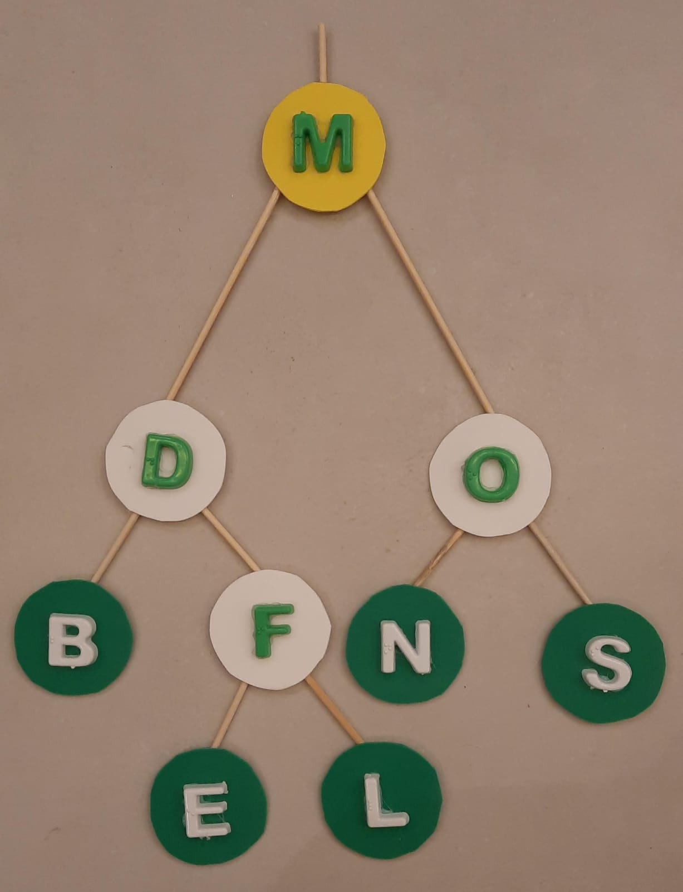
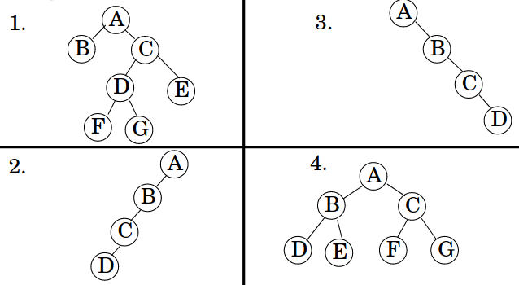
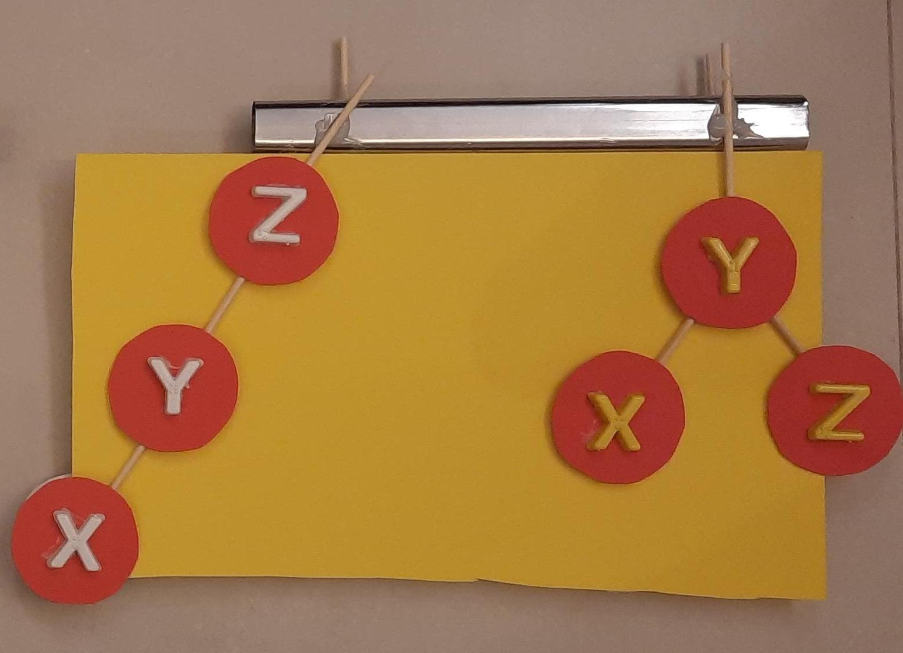
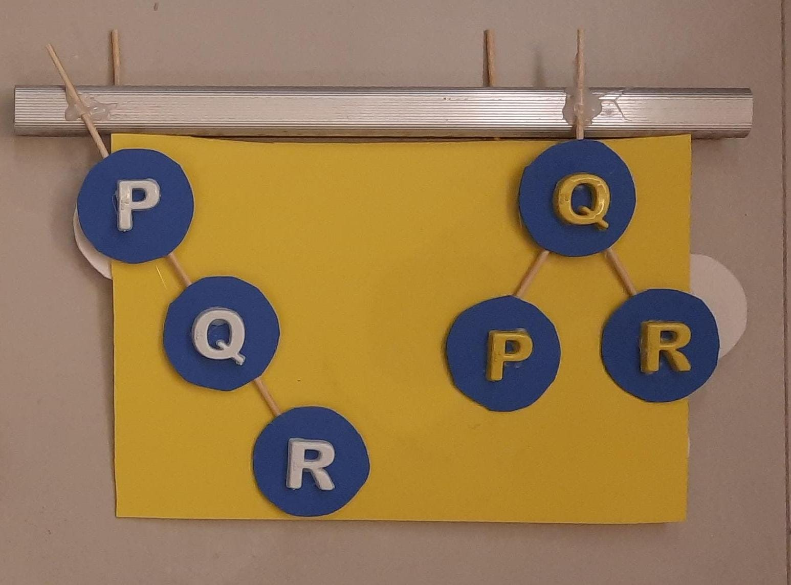
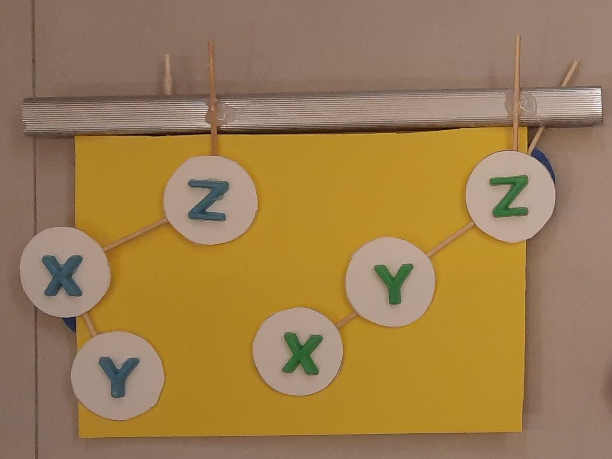
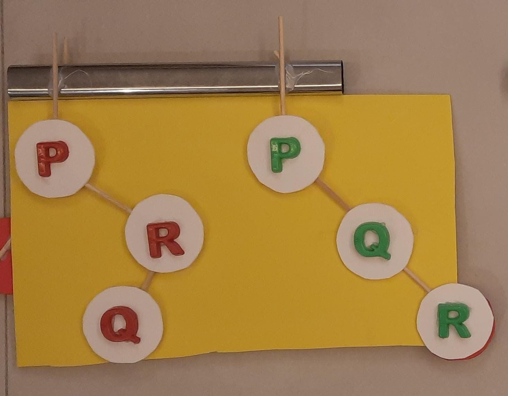

# Dicionários Ordenados

------

## Pré-Requisitos

São requisitos para essa aula:

- Introdução/Fundamentos de Programação (em alguma linguagem de programação)
- Interesse em aprender C/C++
- Noções de recursividade
- Noções de listas e encadeamento
- Aula de Árvores (e Árvores de Busca)
- Aula de Dicionários e Tabelas de Dispersão
- Tópico avançado de Sacos Ordenados (recomendado)

*Agradecimentos especiais ao prof. Fabiano Oliveira e prof. Fábio Protti, cujo conteúdo didático forma a base desses slides*

------

## Revisão: Dicionário

Na aula anterior, definimos o **Dicionário**: um TAD que associa **chaves** (sem repetição) a **valores**.

::: -

```.cpp
template <typename D, typename K, typename V>
concept DicionarioTAD = requires(D d, K k, V v) {
   { d.tem(k) }      -> std::same_as<bool>;  // chave existe?
   { d.consulta(k) } -> std::same_as<V>;     // valor (pre: tem(k))
   { d.adiciona(k, v) };                     // insere ou atualiza
   { d.remove(k) }   -> std::same_as<bool>;  // removeu?
   { d.tamanho() }   -> std::same_as<int>;   // num. de chaves
};
```

:::

Com **Tabelas de Dispersão**, todas essas operações custam $O(1)$ **em média**. Excelente!

Mas vimos também uma **limitação importante**...

------

## Motivação: Perguntas sobre a Ordem

Uma tabela de dispersão **espalha** as chaves de propósito. Perguntas sobre a **ordem** ficam caras:

- qual a **menor** chave? E a **maior**?
- qual a **primeira chave $\geq x$**? (ex: o próximo horário livre a partir das 14h)
- quais chaves estão **entre $a$ e $b$**? (ex: todas as vendas entre duas datas)
- percorrer as chaves **em ordem crescente**

Na tabela de dispersão, todas custam $O(M + n)$: é preciso olhar tudo!

**Lembra do Saco Ordenado?** Com o vetor ordenado, essas perguntas custavam $O(\log n)$, com `buscaMaiorIgual` e `buscaMaior`... mas inserir e remover custavam $O(n)$.

***Objetivo desta aula:*** *responder às perguntas sobre a ordem **e** atualizar em $O(\log n)$.*

------

## Dicionário Ordenado

Um *Dicionário Ordenado* é um Dicionário cujas chaves podem ser **comparadas**, e que oferece:

- **percurso em ordem:** o iterador visita as chaves em **ordem crescente**
- `buscaMaiorIgual(c)`: posição da **primeira chave $\geq c$**
- `buscaMaior(c)`: posição da **primeira chave $> c$**

Exemplo com as chaves `B D E F L M N O S`:

```
 B   D   E   F   L   M   N   O   S
             ^   ^
   buscaMaiorIgual('F')   buscaMaior('F')
   buscaMaiorIgual('G') = buscaMaiorIgual('H') = ... = posição de L
```

Com elas, construímos as demais perguntas: **mínimo** (primeira do percurso), **intervalo** $[a, b]$ (de `buscaMaiorIgual(a)` até passar de $b$), **sucessor** de uma chave, etc.

Na STL: `lower_bound` (buscaMaiorIgual) e `upper_bound` (buscaMaior) do `std::map`. No Java: `ceilingKey` e `higherKey` do `TreeMap`.

------

## O Tipo Entrada

Ao percorrer um dicionário, o iterador lê a **entrada atual**: uma **vista** da chave e uma **vista mutável** do valor, que ficam *dentro* do dicionário.

::: -

:::::::::: ||

::::: |{50%}

```.cpp
template <typename T> struct Vista {
   using Tipo = T;
   const T* origem;
   T le() { return *origem; }
};
template <typename T> struct VistaMutavel {
   using Tipo = T;
   T* origem;
   T le() { return *origem; }
   void altera(T v) { *origem = v; }
};
template <typename K, typename V>
struct Entrada {
   Vista<K>        chave;  // só leitura!
   VistaMutavel<V> valor;  // leitura e escrita
};
```

:::::

::::: |{45%}

São as Vistas da aula de Sacos, agora **genéricas** (`Vista<int>` é a nossa `VistaInt`).

- a **chave** é só uma `Vista`: alterá-la quebraria a **ordem** da estrutura!
- o **valor** é uma `VistaMutavel`: pode ser alterado **no próprio dicionário**

Na STL: `std::pair<const K, V>&`. No Java: `Map.Entry<K, V>` (tem `setValue`, mas não `setKey`).

:::::

::::::::::

:::

------

## Conceito: Dicionário Ordenado

Um Dicionário Ordenado é um Dicionário **e** um Percorrível de **entradas** (em ordem de chave), com as duas buscas por ordem:

::: -

:::::::::: ||

::::: |{55%}

```.cpp
template <typename D, typename K, typename V>
concept DicionarioOrdenadoTAD =
   DicionarioTAD<D, K, V> &&
   PercorrivelTAD<D, Entrada<K, V>> &&
   std::totally_ordered<K> &&  // comparáveis
   requires(D d, K k) {
   // 1a entrada com chave >= k
   { d.buscaMaiorIgual(k) }
         -> IteradorTAD<Entrada<K, V>>;
   // 1a entrada com chave > k
   { d.buscaMaior(k) }
         -> IteradorTAD<Entrada<K, V>>;
};
```

:::::

::::: |{40%}

O iterador é uma **Vista** da entrada atual:

```.cpp
struct IteradorDicCF {
   using Tipo = Entrada<char, float>;
   ...
   Tipo le();       // vistas {chave, valor}
   bool terminou();
   void proximo();  // próxima chave
};
```

:::::

::::::::::

:::

***Atenção:*** o conceito verifica que as operações **existem**, mas não que o percurso está **em ordem**: essa invariante o compilador não verifica!

------

## Exemplo de Uso

::: -

:::::::::: ||

::::: |{50%}

```.cpp
// chaves: B D E F L M N O S
DicionarioOrdenadoTAD<char, float> auto d = ...;

// mínimo: primeira chave do percurso
println("{}",
    d.iterador().le().chave.le());           // B

// primeira chave >= 'G'
println("{}",
    d.buscaMaiorIgual('G').le().chave.le()); // L

// primeira chave > 'F'
println("{}",
    d.buscaMaior('F').le().chave.le());      // L
```

:::::

::::: |{45%}

```.cpp
// todas as entradas em [D, M]
auto it = d.buscaMaiorIgual('D');
while (!it.terminou() &&
       it.le().chave.le() <= 'M') {
   auto [c, v] = it.le();
   println("{} -> {}", c.le(), v.le());
   it.proximo();   // D E F L M
}
```

Custo: $O(\log n)$ para achar o início, mais $O(k)$ para visitar as $k$ entradas do intervalo.

:::::

::::::::::

:::

**Desafio:** escreva `buscaMaior(c)` usando apenas `buscaMaiorIgual` e o iterador.

------

## Modificando Durante o Percurso

**Alterar valores** não muda a estrutura: basta usar a vista mutável do valor, sem invalidar nada.

**Inserir ou remover chaves** invalida os iteradores (como no Saco). Mas podemos **continuar pela chave**: `buscaMaior(c)` encontra a entrada seguinte!

::: -

:::::::::: ||

::::: |{48%}

```.cpp
// dobra os valores em [D, M]
auto it = d.buscaMaiorIgual('D');
while (!it.terminou() &&
       it.le().chave.le() <= 'M') {
   auto [c, v] = it.le();
   v.altera(2 * v.le()); // no lugar!
   it.proximo();
}
```

:::::

::::: |{48%}

```.cpp
// remove as chaves de valor ímpar
auto it = d.buscaMaiorIgual('D');
while (!it.terminou() &&
       it.le().chave.le() <= 'M') {
   char c = it.le().chave.le();
   if ((int)it.le().valor.le() % 2 == 1)
      d.remove(c);       // invalida 'it'
   it = d.buscaMaior(c); // continua pela CHAVE
}
```

:::::

::::::::::

:::

`buscaMaior(c)` custa $O(\log n)$, o mesmo que o `remove`: retomar o percurso sai **de graça** (assintoticamente)!

------

## Como implementar um Dicionário Ordenado?

::: -

| Implementação | `adiciona`, `remove` | `consulta` | `buscaMaiorIgual` | percurso em ordem |
|---|---|---|---|---|
| tabela de dispersão | $O(1)$ médio | $O(1)$ médio | $O(M + n)$ | ordenar: $O(n \log n)$ |
| vetor ordenado (Saco Ordenado) | $O(n)$ | $O(\log n)$ | $O(\log n)$ | $O(n)$ |
| árvore de busca (ABB) | $O(h)$ | $O(h)$ | $O(h)$ | $O(n)$ |
| **árvore balanceada** (esta aula!) | $\mathbf{O(\log n)}$ | $\mathbf{O(\log n)}$ | $\mathbf{O(\log n)}$ | $O(n)$ |

:::

A Árvore Binária de Busca (ABB) já mantém as chaves **em ordem**: o percurso em-ordem visita as chaves de forma crescente, e as buscas por ordem descem um caminho da raiz. O problema é a altura $h$, que pode chegar a $n$...

**A solução desta aula:** manter a árvore **balanceada**, com $h = O(\log n)$!


# Árvores Binárias de Busca (breve revisão)

## Árvore Binária de Busca: Exemplo

Exemplos de ABB, contendo nós D, E, F, L, M, N e O.

::::::::::{.columns}

:::::{.column width=45%}

{height=40%}

:::::

:::::{.column  width=50%}

{height=40%}

:::::

::::::::::

# Árvores Auto-Balanceadas

-------

## Árvores Auto-Balanceadas

Um tipo importante de Árvore Binária de Busca é a *auto-balanceada*, que resolve o problema de degeneração da árvore pelo controle de sua altura.

Já vimos que, nesse curso, uma árvore T é *$c$-balanceada* se todo nó X de T respeita $h(X) \leq c \cdot s(X)$: daí temos que $h(T) \in O(\lg n)$.
Veremos dois tipos de árvores auto-balanceadas para $c=2$: a AVL e Rubro-Negra.

Na AVL, tal controle é conseguido pelo cálculo de um **fator de balanceamento (FB)** para cada nó, definido por: altura do filho esquerdo - altura do filho direito. Observe que se o filho não existe, então sua altura será 0 (zero).

---------

## Exercício

Calcule o fator de balanceamento da raiz das quatro árvores abaixo e informe se estão balanceadas:


::::::::::{.columns}

:::::{.column width=70%}

{width=90%}

:::::

:::::{.column  width=30%}

{height=40%}

:::::

::::::::::

. . .

**Solução:** 1. $1-3=-2$ (não), 2. $0-3=-3$ (não), 3. $3-0=3$ (não), 4. $2-2=0$ (sim), Fig.7 $3-2=1$ (sim)

# Operações Básicas em ABBB (Exercícios Práticos)

## Exercício: Calcule a altura de um nó de uma ABBB

Considere uma Árvore Binária de Busca Balanceada (ABBB) com controle de altura.
Dado um nó do tipo `NoEnc7`, calcule a altura com base na altura dos filhos.
Faça um método auxiliar `get_altura(no)`, que dá altura zero para um nó vazio:

`int get_altura(const NoEnc7* no) { ... }`

`int calc_altura(const NoEnc7* no)  { ... }`

:::::::: ||
::::: |{30%}

```.cpp
struct NoEnc7 {
   char chave;  
   float dado; 
   int h;      
   NoEnc7* esq; 
   NoEnc7* dir; 
   NoEnc7* pai;  
};
```

:::::

. . .

::::: |{55%}

```.cpp
int get_altura(const NoEnc7* no) {
   return no ? no->h : 0; 
}
int calc_altura(const NoEnc7* no) 
{                      // pre(no)
    int he = get_altura(no->esq);
    int hd = get_altura(no->dir);
    return 1 + (he > hd? he : hd); 
}
```

:::::
::::::::

## Exercício: Calcule o fator de balanceamento de uma ABBB

Considere uma Árvore Binária de Busca Balanceada (ABBB) com controle de altura.
Dado um nó do tipo `NoEnc7`, calcule o fator de balanceamento 
com método auxiliar `get_altura(no)` já criado previamente:

`int fb(const NoEnc7* no)  { ... }`

:::::::: ||
::::: |{30%}

```.cpp
struct NoEnc7 {
   char chave;  
   float dado; 
   int h;      
   NoEnc7* esq; 
   NoEnc7* dir; 
   NoEnc7* pai;  
};
```

:::::

. . .

::::: |{55%}

```.cpp
int get_altura(const NoEnc7* no) {
   return no ? no->h : 0; 
}

int fb(const NoEnc7* no)
// pre(no)               // C++26
{ 
   return get_altura(no->esq) - 
          get_altura(no->dir); 
}
```

:::::
::::::::

## Exercício: Propriedade de um nó regulado em ABBB

Dado um nó do tipo `NoEnc7`, escreva a propriedade `eh_regulado`,
que retorna verdadeiro caso seu fator de balanceamento seja no máximo 1 em módulo:

`bool eh_regulado(auto* no) { ... }`

:::::::: ||
::::: |{30%}

```.cpp
struct NoEnc7 {
   char chave;  
   float dado; 
   int h;      
   NoEnc7* esq; 
   NoEnc7* dir; 
   NoEnc7* pai;  
};
```

:::::

. . .

::::: |{55%}

```.cpp
bool eh_regulado(auto* no) 
// pre(no)        // C++26
{
    return fb(no) == 1 || 
           fb(no) == 0 || 
           fb(no) == -1;
} 
```

:::::
::::::::


# Implementação de Dicionário

## Dicionário com AVL

Existem duas implementações populares de árvores auto-balanceadas para dicionários: AVL e rubro-negra.

Iremos explorar a árvore AVL, por sua simplicidade.

Criada em 1962 pelos russos Georgy Adelson-Velsky e Evgenii Landis, ela consegue manter um balanceamento após uma operação de inserção ou remoção.

Basta calcular o fator de balanceamento em cada nó e, caso esteja desbalanceada, algum tipo de operação de rotação será feita.

Nos próximos slides demonstramos as rotações possíveis.


## Rotação Simples à Direita

Ocorre quando os fatores de balanceamento são 2 e 1 (ou 0).

{height=40%}

Após rotação à direita, a árvore fica enraizada em Y, com X à esquerda e Y à direita.

## Rotação Simples à Esquerda

Ocorre quando os fatores de balanceamento são -2 e -1 (ou 0).

{height=40%}

Após rotação à direita, a árvore fica enraizada em Q, com P à esquerda e R à direita.


## Rotação Dupla à Direita

Ocorre quando os fatores de balanceamento são 2 e -1.
Isso exige duas rotações, uma à esquerda e outra à direita.

::::::::::{.columns}

:::::{.column width=50%}

{height=40%}

:::::

:::::{.column  width=50%}

{height=40%}

:::::

::::::::::


Após rotação à esquerda em X, a árvore fica enraizada em Z, mas ainda desbalanceada como 2 1.
Uma nova rotação à direita da raiz Z resolve o problema.

## Rotação Dupla à Esquerda

Ocorre quando os fatores de balanceamento são -2 e 1.
Isso exige duas rotações, uma à direita e outra à esquerda.

::::::::::{.columns}

:::::{.column width=50%}

{height=40%}

:::::

:::::{.column  width=50%}

{height=40%}

:::::

::::::::::


Após rotação à direita em R, a árvore fica enraizada em P, mas ainda desbalanceada como -2 -1.
Uma nova rotação à esquerda da raiz P resolve o problema.


## Praticando as Rotações

Considere uma árvore A3 com nós M, D, O, B, F, N, S, E, L.
A exclusão de S não acarreta em desbalanceamento.
A exclusão de B gera um desbalanceamento no nó D, com fator 0-2=-2 seguido de 0.

Isso indica uma Rotação Simples à Esquerda, no nó D.

::::::::::{.columns}

:::::{.column width=70%}

{height=30%}

:::::

:::::{.column  width=30%}

{height=30%}

:::::

::::::::::

Qual o final após a rotação? F substitui D, tornando D seu filho à esquerda e E à direita de D, sendo que o filho à direita de F permanece L.
A árvore se torna balanceada.

# Rotações em AVL (Exercícios Práticos)

## Exercício: Faça uma Rotação à Direita em uma AVL

Dado um nó do tipo `NoEnc7` desregulado (com peso à esquerda), 
faça uma rotação à direita na raiz de uma subárvore e
retorne a nova raiz da subárvore:

`NoEnc7* rotDir(NoEnc7* const raiz) { ... }`

::: -
:::::::: ||
::::: |{30%}

```.cpp
struct NoEnc7 {
   char chave;  
   float dado; 
   int h;      
   NoEnc7* esq; 
   NoEnc7* dir; 
   NoEnc7* pai;  
};
```

:::::

. . .

::::: |{55%}

```.cpp
NoEnc7* rotDir(NoEnc7* const raiz) 
// pre(raiz)             // C++26
{
    auto* x = raiz->esq;
    raiz->esq = x->dir;
    if(x->dir) x->dir->pai = raiz;
    x->dir = raiz;
    x->pai = raiz->pai;
    raiz->pai = x;
    raiz->h = calc_altura(raiz);
    x->h    = calc_altura(x);
    return x;  // nova raiz
}
```

:::::
::::::::
:::

## Exercício: Faça o Balanceamento de um nó de AVL

Dado um nó do tipo `NoEnc7` regulado ou desregulado,
efetue o balanceamento (se necessário) e
retorne a nova raiz da subárvore:

`NoEnc7* balanceia(NoEnc7* const raiz) { ... }`

::: -
:::::::: ||
::::: |{30%}

```.cpp
struct NoEnc7 {
   char chave;  
   float dado; 
   int h;      
   NoEnc7* esq; 
   NoEnc7* dir; 
   NoEnc7* pai;  
};
```

:::::

. . .

::::: |{55%}

```.cpp
NoEnc7* balanceia(NoEnc7* const raiz) 
// pre(raiz)                   // C++26
// post(out: eh_regulado(out)) // C++26
{
  int f = fb(raiz); if (f > 1) {
      if (fb(raiz->esq) < 0)
        raiz->esq = rotEsq(raiz->esq);
    return rotDir(raiz);
  }; if (f < -1) {
      if (fb(raiz->dir) > 0)
        raiz->dir = rotDir(raiz->dir);
      return rotEsq(raiz);
  }
  return raiz; // sem rotação necessária!
}
```

:::::
::::::::
:::

## Algoritmo `rebalanceia` até a raiz em O(h)

::: -

```{.cpp}
auto* rebalanceia(auto* p)          
// pre(p)
{
  auto* raiz = p;
  while (p) {
    auto* avo = p->pai;
    bool era_esq = avo && avo->esq == p;
    p->h = calc_altura(p);
    auto* nova = balanceia(p);      // rotação já ajusta nova->pai
    if (avo) { if (era_esq) avo->esq = nova; else avo->dir = nova; }
    raiz = nova;
    p = avo;
  }
  return raiz;
}
```

:::

# Implementação de AVL

## Estrutura de AVL

Relembrando a estrutura de árvore binária com pai, chave-valor e alturas:

```.cpp
struct NoEnc7 {
   char chave;     // chave de busca
   float dado;     // valor armazenado
   int h;          // altura
   NoEnc7* esq;    // filho esquerdo
   NoEnc7* dir;    // filho direito
   NoEnc7* pai;    // pai
};

struct AVL {
  NoEnc7* raiz;    // raiz da árvore
  int N;           // número de nós
  ...              // métodos típicos: busca, upsert, remove, ...
};
```


## Implementação: `upsertAVL`

Implementação de "upserção" (inserção, se chave nova, ou atualização, se chave já existe) em árvore binária de busca balanceada não-vazia:

::: -
```.cpp
NoEnc7* upsertAVL(char c, float d, NoEnc7* const raiz) 
// pre(raiz)                                  // C++26
{  
  if (c == raiz->chave) { raiz->dado = d; return raiz; }
  if (c < raiz->chave) {
    if (raiz->esq) raiz->esq = upsertAVL(c, d, raiz->esq);
    else raiz->esq = 
      new NoEnc7{.chave=c,.dado=d,.h=1,.esq=0,.dir=0,.pai=raiz};
  } else {
    if (raiz->dir) raiz->dir = upsertAVL(c, d, raiz->dir);
    else raiz->dir = 
      new NoEnc7{.chave=c,.dado=d,.h=1,.esq=0,.dir=0,.pai=raiz};
  }
  raiz->h = calc_altura(raiz); // sempre muda altura até raiz!
  return balanceia(raiz);
}
```
:::

## Algoritmo de Remoção em AVL

::: -

```{.cpp}
auto removeAVL(char c, auto* raiz) {
  if(!raiz) return std::tuple{false, raiz};    // árvore vazia
  auto* no = ::buscaABB(raiz, c);    if(!no)   return std::tuple{false, raiz};
  auto* alvo = tem_dois_filhos(no) ? sucessor(no) : no;  // nó a desligar
  no->chave = alvo->chave;  no->dado = alvo->dado;       // se no==alvo, nada muda
  auto [pai, filho] = extrai(alvo);  // 'alvo' tem no máximo um filho
  delete alvo;
  auto* inicio = pai ? pai : filho;  // de onde subir rebalanceando
  return std::tuple{true, inicio ? rebalanceia(inicio) : inicio};
}
```

:::

## Exemplo de Remoção

Remova o `A`:

```
              E                    FB:  E = -1
           /     \                      B = -1,  C = -1
         B         H                    H = -1,  G = +1
        / \       / \                   J = -1,  K = -1
       A   C     G   J
            \   /   / \
             D F   I   K
                        \
                         L
```       

# Análise da AVL

## Sobre Análise de Complexidade da AVL (revisão)

Para analisar a AVL, retomaremos conceitos importantes apresentados em aulas anteriores (de Árvores binárias):

- semifolha: nós com pelo menos uma subárvore vazia 
   * obs: as folhas também são semifolhas!
- distância: tamanho de um caminho entre um par de nós
- rank (ou s-valor): menor distância do nó $X$ até uma semifolha descendente, denominado $s(X)$
   * para semifolha vale 1, e para árvore vazia vale 0
- altura: maior distância entre um nó $X$ e uma folha descendente, denominado $h(X)$
   * para folha vale 1, e para árvore vazia vale 0
- árvore balanceada: árvore com altura limitada $h \in O(\log n)$, via relação $h \leq c \cdot s$
   * tipicamente $2$-balanceada, ou seja, que respeita a relação $h(X) \leq 2 \cdot s(X)$ para todo nó
- Para uma altura $h$, $N_{min}(h) = h$ (um caminho) e $N_{max}(h)=2^h - 1$ (árvore perfeita)
   * sempre vale $N_{min} \leq n \leq N_{max}$, e portanto, $n \geq N_{min}(h)$ 
   * encontrando $N_{min}(h)$ você necessariamente encontra uma **altura máxima** para dada árvore!

## Exercício Prático: AVL é uma Árvore Balanceada

Assuma que T é uma árvore AVL. Para cada nó X de T, afirmamos que $s(X) \geq \lceil h(X)/2\rceil$.

Para árvores pequenas, a afirmação vale (base). Nó vazio: $h = 0$ e $s=0$. Nó folha: $h = 1$ e $s = 1$.
Suponha que, para toda subárvore AVL de altura menor que $h$, a afirmação vale (hipótese de indução).

Considere $h \geq 2$ (passo indutivo):

Pela definição recursiva, os filhos de T também são AVL, com alturas $h-1$ e $h-2$, ou $h-1$ e $h-1$. 

Ambas são menores que $h$, então a hipótese se aplica a eles: 
cada filho X tem $s(X) \geq \lceil (h-2)/2\rceil = \lceil h/2\rceil - 1$. 

Logo $s(T) = 1 + \min(s(T_E), s(T_D)) \geq 1 + \min(\lceil h/2\rceil - 1, \lceil h/2\rceil - 1) = \lceil h/2\rceil$.

Assim, $h(X) \leq 2 \cdot s(X)$ em todo nó, ou seja, a AVL é balanceada. Lembrando que toda árvore balanceada tem altura logarítmica $h \leq 2\cdot lg(n+1)$.

---------

## Sequência de Fibonacci (Revisão)

A *sequência de Fibonacci* é definida por $F(0) = 0$, $F(1) = 1$ e $F(k) = F(k-1) + F(k-2)$, para $k \geq 2$:

::: --

| $k$ | 1 | 2 | 3 | 4 | 5 | 6 | 7 | 8 | 9 | 10 |
|---|---|---|---|---|---|---|---|---|---|---|
| $F(k)$ | 1 | 1 | 2 | 3 | 5 | 8 | 13 | 21 | 34 | 55 |
| $\frac{F(k)}{F(k-1)}$ | - | 1 | 2 | 1,5 | 1,67 | 1,6 | 1,625 | 1,615 | 1,619 | 1,618 |

:::

**Intuição:** a razão entre termos consecutivos se estabiliza em torno de $1{,}618$. Ou seja, para $k$ grande, $F(k) \approx 1{,}618 \cdot F(k-1)$: a sequência se comporta quase como uma *progressão geométrica*, crescendo *exponencialmente*.

Esse valor é o *número de ouro* (ou *razão áurea*), denotado por $\varphi$.

--------

## Número de Ouro: Calculando $F(k)$

**Desafio:** se $F(k)$ se comporta como uma progressão geométrica $r^k$, quanto vale $r$?

1. Substituindo $F(k) = r^k$ na recorrência: $r^k = r^{k-1} + r^{k-2}$
2. Dividindo por $r^{k-2}$: $r^2 = r + 1$, ou seja, $r^2 - r - 1 = 0$
3. Por Bhaskara: $\Delta = (-1)^2 - 4 \cdot 1 \cdot (-1) = 5$, logo $r = \frac{1 \pm \sqrt{5}}{2}$
4. A raiz positiva é o número de ouro, $\varphi = \frac{1 + \sqrt{5}}{2} \approx 1{,}618$ (a outra é $\psi = \frac{1 - \sqrt{5}}{2} \approx -0{,}618$)

**Propriedade fundamental:** $\varphi^2 = \varphi + 1$ (vem do passo 2).

**Observação:** como a recorrência é linear, qualquer combinação $a\varphi^k + b\psi^k$ também a satisfaz. 

Para que ela seja $F(k)$, usamos $F(0) = 0$ e $F(1) = 1$. Para $k=0$: $a\varphi^0 + b\psi^0 = a + b = 0$, ou seja, $b = -a$. Para $k=1$: $a\varphi + b\psi = 1$, e substituindo $b = -a$, temos $a\varphi - a\psi = 1$, ou seja, $a(\varphi - \psi) = 1$.

Como $\varphi - \psi = \sqrt{5}$, temos $a = -b = \frac{1}{\sqrt{5}}$, obtendo a *fórmula de Binet*: $F(k) = \frac{\varphi^k - \psi^k}{\sqrt{5}} \approx \frac{\varphi^k}{\sqrt{5}}$ (pois $|\psi| < 1$).

----------

## Árvore de Fibonacci (AVL Mínima)

Seja $N^*(h)$ o menor número de nós de uma AVL de altura $h$.
**Desafio:** encontre $N^*(h)$.

:::::::::: ||

::::: |{60%}

Uma subárvore mínima de altura $h-1$, e outra mínima com a menor altura permitida, $h-2$:

$N^*(h) = 1 + N^*(h-1) + N^*(h-2)$, com $N^*(0) = 0$ e $N^*(1) = 1$

Somando $1$ dos dois lados, $N^*(h) + 1 = (N^*(h-1) + 1) + (N^*(h-2) + 1)$ segue a recorrência de Fibonacci, começando em $1 = F(2)$ e $2 = F(3)$. Logo, $N^*(h) = F(h+2) - 1$.

:::::

::::: |{35%}

```
          E
        /   \
       C     G
      / \   /
     B   D F
    /
   A
```

Altura $4$: $F(6) - 1 = 7$ nós.

:::::

::::::::::

Essas AVLs mínimas são as *árvores de Fibonacci*: raiz, com árvores de Fibonacci de alturas $h-1$ e $h-2$ como filhos. Em todo nó, as alturas dos filhos diferem de exatamente $1$, logo são AVL.

--------

## Altura da AVL

Uma AVL com altura $h$ tem $n \geq N^*(h)$ nós. Somando $1$ dos dois lados e usando Binet:

$n + 1 \geq N^*(h) + 1 = F(h+2) \cancel{-1} \cancel{+1} \approx \frac{\varphi^{h+2}}{\sqrt{5}}$, ou seja, $\boxed{n+1 \gtrsim \frac{\varphi^{h+2}}{\sqrt{5}}}$

Temos que o número de nós cresce *exponencialmente* com a altura, como $\varphi^h$. 

Multiplicando por $\sqrt{5}$ e invertendo o lado: $\varphi^{h+2} \lesssim \sqrt{5} \cdot (n+1)$

Aplicando o logaritmo na base $\varphi$: $h + 2 \lesssim log_\varphi(\sqrt{5} \cdot (n+1)) = log_\varphi(n+1) + log_\varphi \sqrt{5}$

Subtraindo $2$ dos dois lados:

$\boxed{h \lesssim log_\varphi(n+1) + (log_\varphi \sqrt{5} - 2) \approx 1{,}44 \cdot lg(n+1) - 0{,}33}$, ou seja, $h \in O(1{,}44 \lg n)$

pois $log_\varphi\, x = \frac{lg\, x}{lg\, \varphi}$, com $\frac{1}{lg\, \varphi} \approx 1{,}44$, e $log_\varphi \sqrt{5} - 2 \approx 1{,}67 - 2 = -0{,}33$.

**Exemplo:** com $n = 2^{20} - 1$, temos $h \lesssim 1{,}44 \cdot 20 - 0{,}33 \approx 28{,}5$, ou seja, $h \leq 28$, contra $40$ de uma árvore $2$-balanceada qualquer.

# Árvores Rubro-Negras

## Conceito: Nós Externos (ou *Folhas Externas*)

Uma subárvore vazia será chamada Nó Externo (ou Folha Externa).

**Desafio:** quantas folhas externas existem em uma árvore binária com $n$ nós?

. . .

**Solução:** $n+1$ (são $2n$ arestas, e $n-1$ deles apontam para nós).


**Observação:** O termo *nó externo* segue [Knuth97] (árvore binária estendida).


## Árvore Rubro-Negra: O que é?

Uma *árvore rubro-negra* é uma ABB em que cada nó possui uma **cor** (vermelho ou preto), usada para controlar o balanceamento no lugar da altura.

- Proposta por Bayer (1972) como *árvore B binária simétrica*; o nome rubro-negra vem de Guibas e Sedgewick (1978)
- Os ponteiros nulos são tratados como **nós nulos** (ou externos), todos pretos
- Basta trocar o campo `int h` do `NoEnc7` por um `bool vermelho` (1 bit de informação!)
- Usada em `std::map`/`std::set` (libstdc++), `TreeMap` (Java) e no kernel Linux

**Ideia:** o balanceamento é *menos rígido* que na AVL (árvore um pouco mais alta), em troca de *menos rotações* nas atualizações.

-------

## Propriedades da Árvore Rubro-Negra

Além das propriedades de ABB, uma árvore rubro-negra satisfaz:

1. Todo nó é vermelho ou preto
2. Todo nó nulo é considerado preto
3. Um nó vermelho não possui filho vermelho (*não há vermelhos consecutivos*)
4. Todo caminho de um nó $X$ até qualquer nó nulo descendente passa pelo mesmo número de nós pretos
5. (Conclusão) Se um nó tem exatamente um filho, esse filho é vermelho (e é folha)

**Exercício:** justifique a propriedade 5 usando as propriedades 2, 3 e 4.

. . . 

**Propriedade 5:** se N tem só o filho C, o lado vazio de N tem 0 pretos internos. 
Se C fosse preto, os caminhos por C teriam pelo menos 1 preto interno, violando a propriedade 4. 
Logo C é vermelho. 
Pelo mesmo motivo, os filhos de C não podem ser nós internos pretos, e pela propriedade 3 também não podem ser vermelhos. 
Então C é folha.

## Altura Negra

**Altura negra** $bh(X)$: número de nós pretos de um caminho de $X$ até um nó nulo, sem contar $X$ (bem definida pela propriedade 4).

**Observações:**

- Alguns autores (Cormen et al.) exigem *raiz preta*; outros não (Mehlhorn e Sanders, Sedgewick e Wayne). Pintar uma raiz vermelha de preto nunca quebra as propriedades, e sem essa regra *toda subárvore de uma rubro-negra também é rubro-negra*
- Toda árvore binária perfeita só com nós pretos é rubro-negra

-------

## Exemplo: Árvore $A3$ Colorida

:::::::: ||
::::: |{55%}

```
                M(P)
            /          \
        D(V)            O(P)
       /    \          /    \
    B(P)    F(P)    N(V)    S(V)
    /  \    /  \    /  \    /  \
  []   [] E(V) L(V) []  []  []  []
          / \  / \
        []  [] [] []
```

:::::

::::: |{40%}

(P) preto, (V) vermelho, `[]` nó nulo (preto)

- Vermelhos ($D$, $E$, $L$, $N$, $S$) só têm filhos pretos
- $bh(M) = 2$ em todo caminho:
   * $M \to D \to B \to$ `[]`: pretos $B$, `[]`
   * $M \to D \to F \to E \to$ `[]`: pretos $F$, `[]`
   * $M \to O \to N \to$ `[]`: pretos $O$, `[]`
- $n = 9$ nós internos e $n + 1 = 10$ nulos
- A subárvore de $D$ (raiz vermelha) também é rubro-negra

:::::
::::::::

**Exercício:** pinte $M$ de vermelho. E se, em vez disso, pintar $D$ de preto? Quais propriedades deixam de valer?

-------

## Operações Básicas em Rubro-Negra

Muito do que já foi visto se reaproveita:

- **Busca, mínimo e sucessor:** idênticos aos da ABB (`buscaABB`, `minimo`, `sucessor`), pois a cor não interfere na ordem
- **Rotações:** as mesmas `rotDir`/`rotEsq` da AVL, sem as linhas que atualizam `h`
- **Recoloração:** trocar a cor de um nó, em $O(1)$

```.cpp
struct NoEnc8 {
   char chave;      float dado;
   bool vermelho;   // no lugar de 'int h'
   NoEnc8* esq;     NoEnc8* dir;     NoEnc8* pai;
};
bool eh_vermelho(const NoEnc8* no) {
   return no && no->vermelho;   // nó nulo é preto (propriedade 2)
}
```

Compare com `get_altura` da AVL: lá o nó nulo tem altura 0; aqui, o nó nulo é preto.

-------

## Inserção em Rubro-Negra

Insira como na ABB (`upsertABB`) e pinte o novo nó $N$ de **vermelho**: a propriedade 4 continua valendo, mas a 3 pode ser violada. Sejam $P$ o pai, $A$ o avô e $T$ o tio de $N$:

1. $N$ é raiz, ou $P$ é preto: nada a fazer, fim
2. $P$ é vermelho e é raiz: pinte $P$ de preto, fim
3. $P$ e $T$ vermelhos: pinte $P$ e $T$ de preto e $A$ de vermelho; repita com $N := A$ (*sobe dois níveis*)
4. $P$ vermelho e $T$ preto, com $N$ em *zigue-zague* (ex: $N$ à direita de $P$, $P$ à esquerda de $A$): rotacione em $P$, trocando os papéis de $N$ e $P$, e siga para o caso 5
5. $P$ vermelho e $T$ preto, com $N$ *em linha* com $P$ e $A$: rotacione em $A$, pinte $P$ de preto e $A$ de vermelho, fim

O caso 3 pode se repetir $O(\log n)$ vezes, mas só recolore. Rotações: **no máximo 2** (casos 4 e 5).

**Observação:** os casos 4 e 5 juntos são exatamente a *rotação dupla* da AVL!

-------

## Exemplo: Inserção de $G$ na $A3$ Colorida (1/2)

::: -
:::::::: ||
::::: |{48%}

**Antes:** $G$ inserido como vermelho, à esquerda de $L$:

```
         M(P)
       /      \
    D(V)       O(P)
   /    \      /  \
 B(P)   F(P) N(V) S(V)
       /   \
     E(V)  L(V)
           /
         G(V)
```

$L$ e $G$ vermelhos: viola a propriedade 3!
Pai $P=L$ e tio $T=E$ vermelhos, avô $A=F$.

:::::

::::: |{48%}

**Caso 3:** $L$ e $E$ ficam pretos, $F$ fica vermelho:

```
         M(P)
       /      \
    D(V)       O(P)
   /    \      /  \
 B(P)   F(V) N(V) S(V)
       /   \
     E(P)  L(P)
           /
         G(V)
```

Agora $F$ e $D$ são vermelhos! Com $N := F$: pai $P=D$ vermelho, tio $T=O$ preto, em zigue-zague. 
Próximo passo: **rotação à esquerda em $D$** (caso 4).

:::::
::::::::
:::

-------

## Exemplo: Inserção de $G$ na $A3$ Colorida (2/2)

::: -
:::::::: ||
::::: |{48%}

**Caso 4:** rotação à esquerda em $D$:

```
            M(P)
          /      \
       F(V)       O(P)
      /   \       /  \
    D(V)  L(P)  N(V) S(V)
   /  \    /
 B(P) E(P) G(V)
```

Agora $D$, $F$ e $M$ estão em linha. Próximo passo: **rotação à direita em $M$** (caso 5).

:::::

::::: |{48%}

**Caso 5:** rotação à direita em $M$; $F$ fica preto e $M$ fica vermelho:

```
          F(P)
       /       \
    D(V)        M(V)
   /   \       /    \
 B(P)  E(P)  L(P)   O(P)
             /      /  \
           G(V)   N(V) S(V)
```

Altura negra 2 em todo caminho. Fim!

:::::
::::::::
:::

-------

## Remoção em Rubro-Negra

Remova como na ABB (`removeABB`): se o nó tem dois filhos, troque pelo `sucessor`, recaindo em um nó $X$ com no máximo um filho.

- $X$ tem um filho: pela propriedade 5, é uma folha vermelha; substitua $X$ por ele e pinte-o de preto, fim
- $X$ é folha vermelha: remova, fim
- $X$ é folha preta: os caminhos por $X$ perdem um preto (*caso difícil*). Sejam $P$ o pai e $I$ o irmão de $X$:
   1. $X$ é raiz: todos os caminhos perderam um preto igualmente, fim
   2. $I$ vermelho: rotacione em $P$ (para o lado de $X$) e troque as cores de $P$ e $I$; recai nos casos seguintes
   3. $I$ preto com sobrinhos pretos: pinte $I$ de vermelho; se $P$ é vermelho, pinte-o de preto e fim; senão, repita com $X := P$ (*sobe um nível*)
   4. $I$ preto, sobrinho próximo vermelho e distante preto: rotacione em $I$ (para longe de $X$), trocando as cores de $I$ e do sobrinho; recai no caso 5
   5. $I$ preto com sobrinho distante vermelho: rotacione em $P$ (para o lado de $X$), $I$ assume a cor de $P$, e $P$ e o sobrinho distante ficam pretos, fim

O caso 3 pode se repetir $O(\log n)$ vezes, mas só recolore. Rotações: **no máximo 3**.

-------

## Exercício Prático: Rubro-Negra é uma Árvore Balanceada

Afirmamos que $h(X) \leq 2 \cdot s(X)$ para todo nó $X$ (contando nós internos, como na AVL).

Seja $p(X)$ o número de nós pretos *internos* em um caminho de $X$ até um nó nulo (o mesmo para todos os caminhos, pela propriedade 4), e seja $\delta = 1$ se $X$ é vermelho, ou $\delta = 0$ se $X$ é preto.

Considere qualquer caminho de $X$ até um nó nulo, com $k$ nós internos:

- Ele contém os $p(X)$ pretos, e também $X$ se este for vermelho: $k \geq p(X) + \delta$
- Todo vermelho diferente de $X$ tem pai preto no próprio caminho (propriedade 3), e pais distintos: há no máximo $p(X)$ vermelhos além de $X$, logo $k \leq 2 \cdot p(X) + \delta$

Aplicando ao caminho mais curto e ao mais longo:

$s(X) \geq p(X) + \delta \quad$ e $\quad h(X) \leq 2 \cdot p(X) + \delta \leq 2 \cdot (p(X) + \delta) \leq 2 \cdot s(X)$

Assim, a rubro-negra é $2$-balanceada e, portanto, $h \leq 2 \cdot lg(n+1)$. $\blacksquare$

*Alternativa (Cormen et al.): por indução, uma subárvore com altura negra $bh$ possui pelo menos $2^{bh} - 1$ nós internos.*

-------

## AVL $\times$ Rubro-Negra

::: --

| | AVL | Rubro-Negra |
|---|---|---|
| Informação por nó | altura (`int h`) | cor (1 bit) |
| Altura máxima | $\approx 1{,}44 \cdot lg(n+1)$ | $2 \cdot lg(n+1)$ |
| Rotações na inserção | no máximo 1 (simples ou dupla) | no máximo 2 |
| Rotações na remoção | até $O(\log n)$ (exemplo anterior!) | no máximo 3 |
| Melhor para | muitas buscas | muitas inserções/remoções |

:::

Ambas garantem busca, inserção e remoção em $O(\log n)$. Na rubro-negra, os ajustes ao subir na árvore são feitos majoritariamente por *recoloração*, que é $O(1)$ por nível.

**Conexão com a próxima aula:** cada nó preto, junto com seus filhos vermelhos, equivale a um nó de uma *Árvore B de ordem 4* (árvore 2-3-4) com até 3 chaves, e $bh$ corresponde à altura dessa Árvore B.

----------

## Próximas aulas

Veremos mais implementações de dicionários, com Tabelas Hash (sem árvores) e com Árvores B (multivias, não binárias!).

Até breve!

----------

## Bibliografia Recomendada


Além da bibliografia do curso, recomendamos para esse tópico:

- Szwarcfiter, J.L; Markenzon, L. Estruturas de Dados e seus Algoritmos. Rio de Janeiro, LTC, 1994.
Bibliografia Adicional:
- Cerqueira, R.; Celes, W.; Rangel, J.L. Introdução a estruturas de dados: com técnicas de programação em C. Editora, 2004.
- Cormen, T.H.; Leiserson, C.E.; Rivest, R.L.; Stein Algoritmos: Teoria e Prática. Ed. Campus, 2002.
- Cormen, T.H.; Leiserson, C.E.; Rivest, R.L.; Stein, C. Introduction to Algorithms, 3rd ed.. The MIT Press, 2009.
- Preiss, B.R. Estruturas de Dados e Algoritmos Ed. Campus, 2000;
- Knuth, D.E. The Art of Computer Programming - Vols I e III. 2nd Edition. Addison Wesley, 1973.
- Graham, R.L., Knuth, D.E., Patashnik, O. Matemática Concreta. Segunda Edição, Rio de Janeiro, LTC, 1995.
- Livro "The C++ Programming Language" de Bjarne Stroustrup
- Dicas e normas C++: https://github.com/isocpp/CppCoreGuidelines


# Agradecimentos

-----

## Pessoas

Em especial, agradeço aos colegas que elaboraram bons materiais, como o prof. Fabiano Oliveira (IME-UERJ), e o prof. Jayme Szwarcfiter cujos conceitos formam o cerne desses slides.

Estendo os agradecimentos aos demais colegas que colaboraram com a elaboração do material do curso de [Pesquisa Operacional](https://github.com/igormcoelho/curso-pesquisa-operacional-i), que abriu caminho para verificação prática dessa tecnologia de slides.

-----

## Software

Esse material de curso só é possível graças aos inúmeros projetos de código-aberto que são necessários a ele, incluindo:

- pandoc
- LaTeX
- GNU/Linux
- git
- markdown-preview-enhanced (github)
- visual studio code
- atom
- revealjs
- groomit-mpx (screen drawing tool)
- xournal (screen drawing tool)
- ...

-----

## Empresas

Agradecimento especial a empresas que suportam projetos livres envolvidos nesse curso:

- github
- gitlab
- microsoft
- google
- ...

-----

## Reprodução do material

Esses slides foram escritos utilizando pandoc, segundo o tutorial ilectures:

- https://igormcoelho.github.io/ilectures-pandoc/

Exceto expressamente mencionado (com as devidas ressalvas ao material cedido por colegas), a licença será Creative Commons.

**Licença:** CC-BY 4.0 2020

Igor Machado Coelho

-------

## This Slide Is Intentionally Blank (for goomit-mpx)
